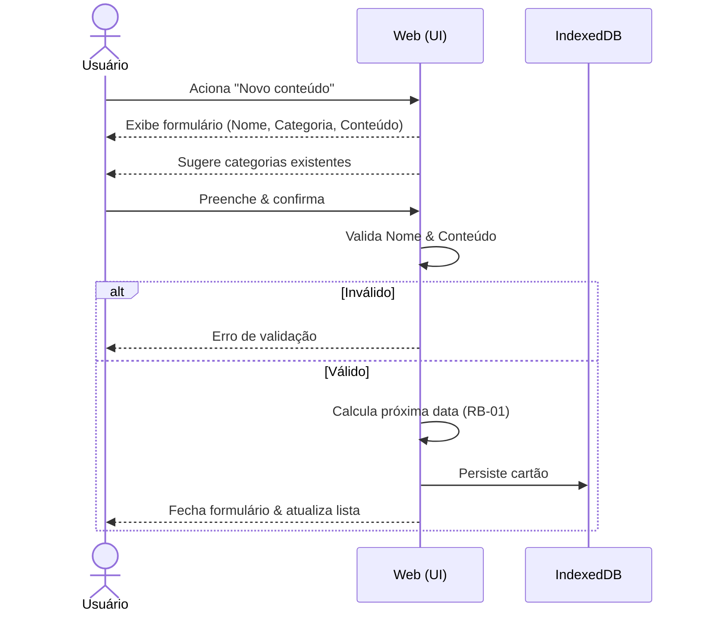
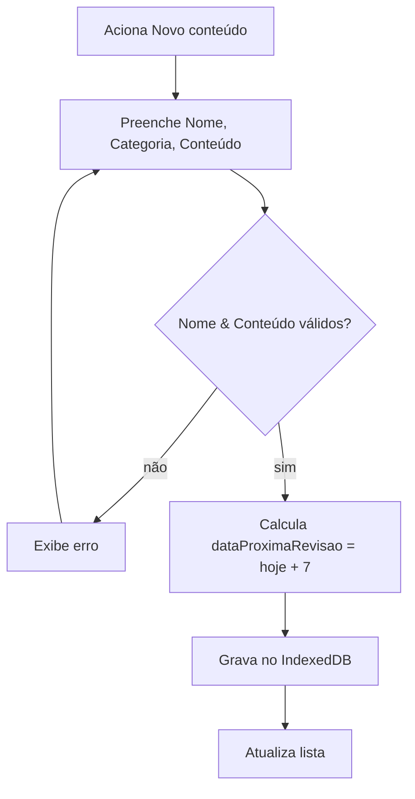

# CDU-01 — Cadastrar conteúdo

## Ator principal
Usuário

## Atores secundários
IndexedDB (browser)

## Pré-condições
- App aberto no browser.

## Pós-condições
- Cartão persistido no IndexedDB.
- Lista (`CDU-02`) atualizada com o novo cartão.

## Fluxo principal
1. Usuário aciona "Novo conteúdo".
2. Sistema exibe o formulário com os campos: **Nome**, **Categoria** & **Conteúdo**.
3. Sistema sugere, no campo Categoria, as categorias já existentes (`RB-02`).
4. Usuário preenche os campos; pode digitar uma categoria nova.
5. Usuário confirma.
6. Sistema valida que Nome & Conteúdo não estão vazios.
7. Sistema grava o cartão (`RNF-01`) com:
   - `dataCriacao = agora`;
   - `dataUltimaRevisao = null`;
   - `quantidadeRevisoes = 0`;
   - `dataProximaRevisao = dataCriacao + 7 dias` (`RB-01`).
8. Sistema fecha o formulário & atualiza a lista.

## Fluxos alternativos / exceções
- **4a. Categoria nova**: usuário digita texto inédito → categoria passa a existir apenas quando o cartão é salvo (`RB-02`).
- **6a. Campos obrigatórios vazios**: sistema exibe erro de validação & mantém o formulário aberto; retorna ao passo 4.
- **5a. Cancelar**: usuário fecha o formulário sem salvar → nenhum cartão é criado.

## Regras de negócio
- `RB-01` (cálculo da próxima data), `RB-02` (categorias).

## Requisitos não funcionais
- `RNF-01`, `RNF-04`, `RNF-05`, `RNF-06`, `RNF-08`, `RNF-09`, `RNF-13`.

## Diagrama

## Rastreabilidade
- Regras: `RB-01`, `RB-02`.
- Relacionado: `CDU-02`.
