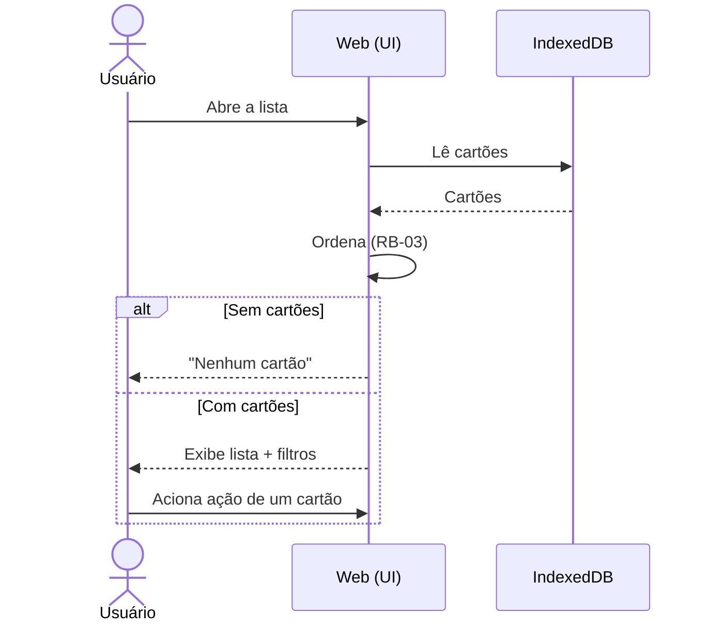
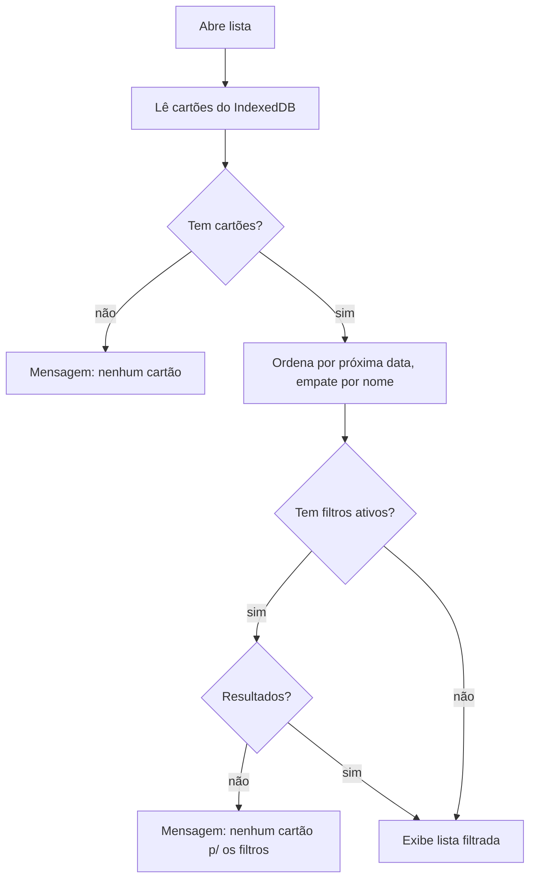

# CDU-02 — Listar conteúdos

## Ator principal
Usuário

## Atores secundários
IndexedDB (browser)

## Pré-condições
- App aberto no browser.

## Pós-condições
- Lista de cartões exibida na ordem de `RB-03`.

## Fluxo principal
1. Usuário abre a app || aciona a lista.
2. Sistema lê os cartões do IndexedDB (`RNF-01`).
3. Sistema ordena por `dataProximaRevisao` ascendente; empate por `nome` ascendente (`RB-03`).
4. Sistema exibe a barra de filtros (data de revisão — `CDU-07`; categoria — `CDU-08`) & a lista.
5. Para cada cartão colapsado, sistema exibe: **data da próxima revisão**, **nome**, **categoria** & os icon buttons: marcar revisado (`CDU-03`), editar (`CDU-05`), excluir (`CDU-06`), expandir (`CDU-04`).
6. Usuário pode acionar qualquer ação de um cartão.

## Fluxos alternativos / exceções
- **2a. Nenhum cartão cadastrado**: sistema exibe mensagem informando que não há cartões (`RB-05`).
- **4a. Filtros ativos sem resultado**: sistema exibe mensagem informando que não há cartões p/ aqueles filtros (`RB-05`).

## Regras de negócio
- `RB-03` (ordenação), `RB-05` (estados vazios).

## Requisitos não funcionais
- `RNF-01`, `RNF-04`, `RNF-05`, `RNF-06`, `RNF-07`.

## Diagrama

## Rastreabilidade
- Regras: `RB-03`, `RB-05`.
- Relacionado: `CDU-01`, `CDU-03`, `CDU-04`, `CDU-05`, `CDU-06`, `CDU-07`, `CDU-08`.
