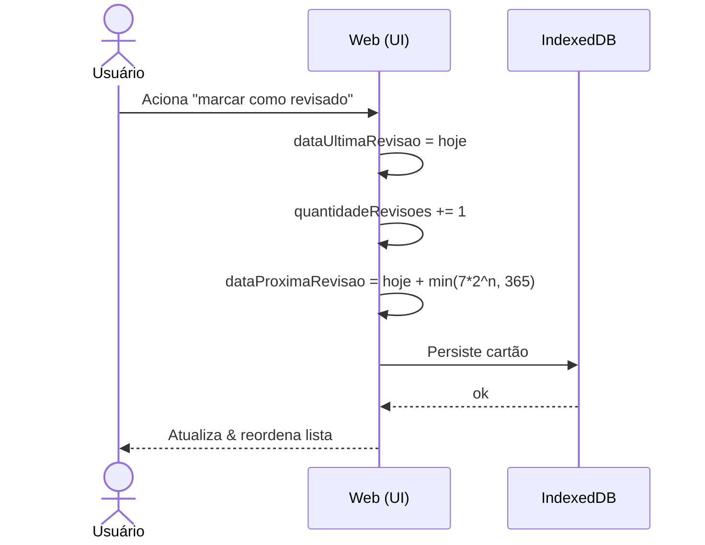
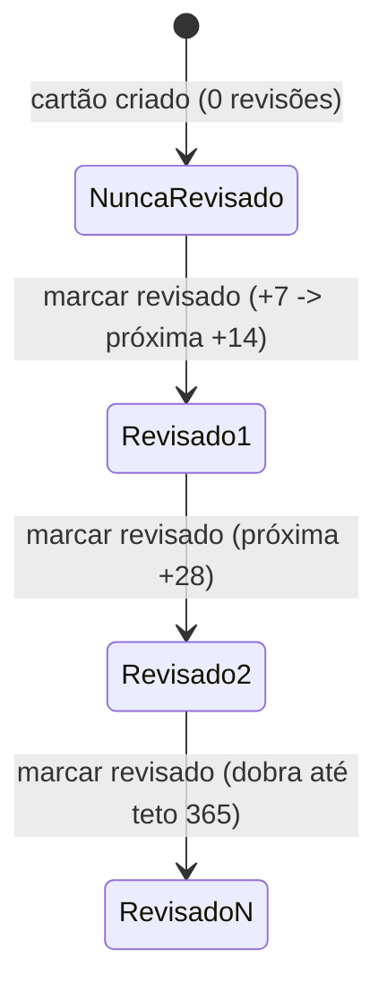

# CDU-03 — Marcar conteúdo como revisado

## Ator principal
Usuário

## Atores secundários
IndexedDB (browser)

## Pré-condições
- Existe ao menos um cartão na lista (`CDU-02`).

## Pós-condições
- `dataUltimaRevisao` & `quantidadeRevisoes` do cartão atualizados.
- `dataProximaRevisao` recalculada (`RB-01`).
- Lista reordenada (`RB-03`).

## Fluxo principal
1. Usuário aciona o **icon button "marcar como revisado"** do cartão (posicionado antes do botão de editar).
2. Sistema define `dataUltimaRevisao = hoje`.
3. Sistema incrementa `quantidadeRevisoes` em 1.
4. Sistema recalcula `dataProximaRevisao = hoje + min(7 × 2^quantidadeRevisoes, 365)` (`RB-01`).
5. Sistema persiste o cartão no IndexedDB (`RNF-01`).
6. Sistema atualiza a lista & reordena (`RB-03`).

## Fluxos alternativos / exceções
- **5a. Falha ao persistir**: sistema exibe mensagem de erro & mantém os valores anteriores; usuário pode tentar novamente.

## Regras de negócio
- `RB-01` (agendamento & teto de 365 dias), `RB-03` (ordenação).

## Requisitos não funcionais
- `RNF-01`, `RNF-06`, `RNF-08`, `RNF-09`, `RNF-12`, `RNF-13`.

## Diagrama

## Rastreabilidade
- Regras: `RB-01`, `RB-03`.
- Relacionado: `CDU-02`.
