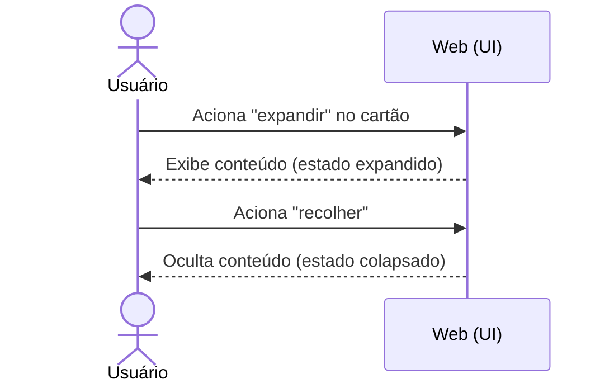
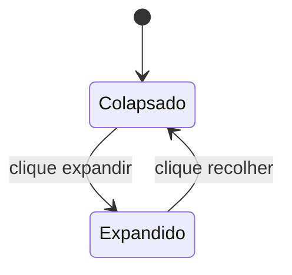

# CDU-04 — Expandir conteúdo

## Ator principal
Usuário

## Atores secundários
—

## Pré-condições
- Existe ao menos um cartão na lista (`CDU-02`).

## Pós-condições
- Cartão exibido no estado expandido, mostrando o conteúdo.

## Fluxo principal
1. Usuário aciona o **icon button "expandir"** do cartão.
2. Sistema alterna o cartão para o estado expandido.
3. Sistema exibe o campo **Conteúdo** do cartão abaixo do cabeçalho (próxima data, nome, categoria & ações).
4. Usuário lê o conteúdo.
5. Usuário aciona novamente "expandir" (agora "recolher") → sistema retorna ao estado colapsado.

## Fluxos alternativos / exceções
- **3a. Conteúdo vazio**: sistema exibe indicador de conteúdo vazio.

## Regras de negócio
- Nenhuma regra de agendamento envolvida.

## Requisitos não funcionais
- `RNF-05`, `RNF-06`, `RNF-07`.

## Diagrama

## Rastreabilidade
- Relacionado: `CDU-02`.
