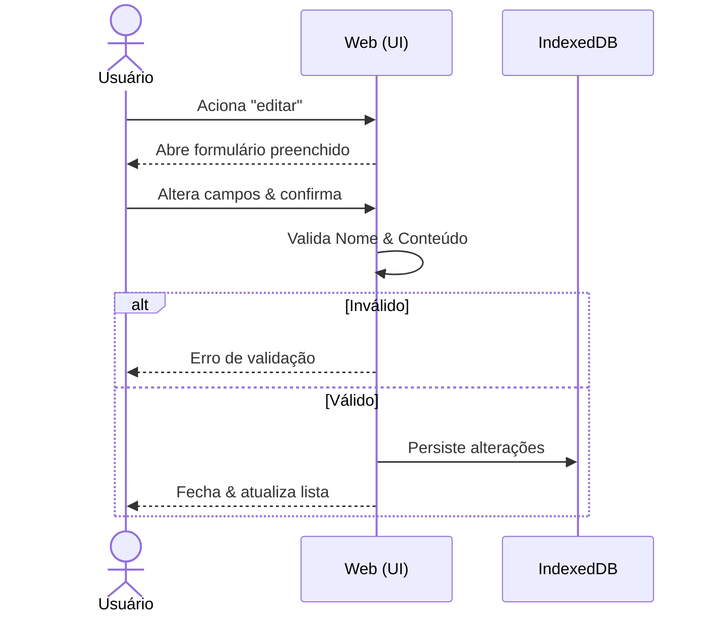
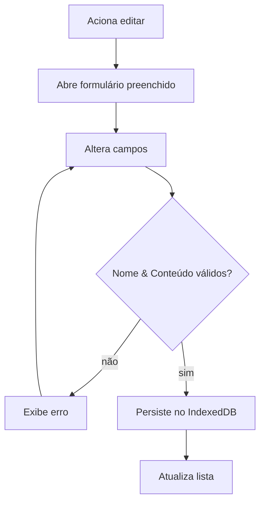

# CDU-05 — Editar conteúdo

## Ator principal
Usuário

## Atores secundários
IndexedDB (browser)

## Pré-condições
- Existe ao menos um cartão na lista (`CDU-02`).

## Pós-condições
- Cartão atualizado no IndexedDB.
- Lista atualizada (`CDU-02`).

## Fluxo principal
1. Usuário aciona o **icon button "editar"** do cartão.
2. Sistema abre o formulário preenchido com Nome, Categoria & Conteúdo atuais.
3. Sistema sugere, no campo Categoria, as categorias já existentes (`RB-02`).
4. Usuário altera os campos; pode digitar uma categoria nova (`RB-02`).
5. Usuário confirma.
6. Sistema valida que Nome & Conteúdo não estão vazios.
7. Sistema persiste as alterações no IndexedDB (`RNF-01`).
8. Sistema fecha o formulário & atualiza a lista.
9. Se categoria mudou, o filtro de categoria (`CDU-08`) passa a refletir as categorias existentes.

## Fluxos alternativos / exceções
- **6a. Campos obrigatórios vazios**: sistema exibe erro & mantém o formulário; retorna ao passo 4.
- **5a. Cancelar**: usuário fecha o formulário → nenhuma alteração é persistida.
- **7a. Falha ao persistir**: sistema exibe erro & mantém o formulário; usuário pode tentar novamente.

## Regras de negócio
- `RB-02` (categorias).

## Requisitos não funcionais
- `RNF-01`, `RNF-04`, `RNF-06`, `RNF-08`, `RNF-13`.

## Diagrama

## Rastreabilidade
- Regras: `RB-02`.
- Relacionado: `CDU-02`, `CDU-08`.
