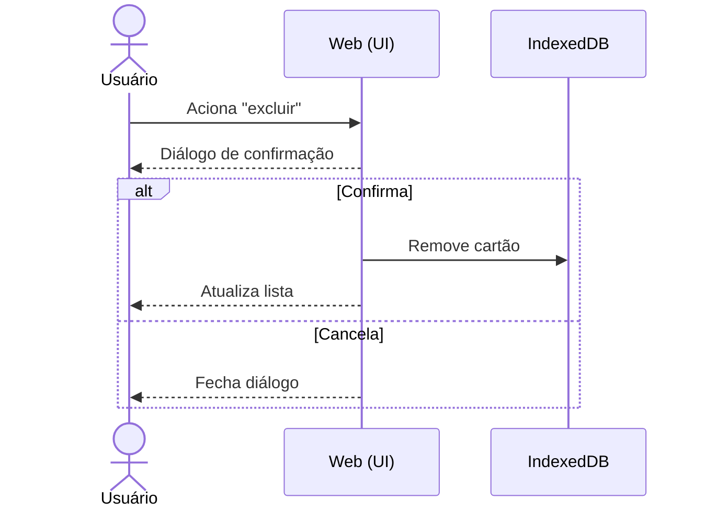
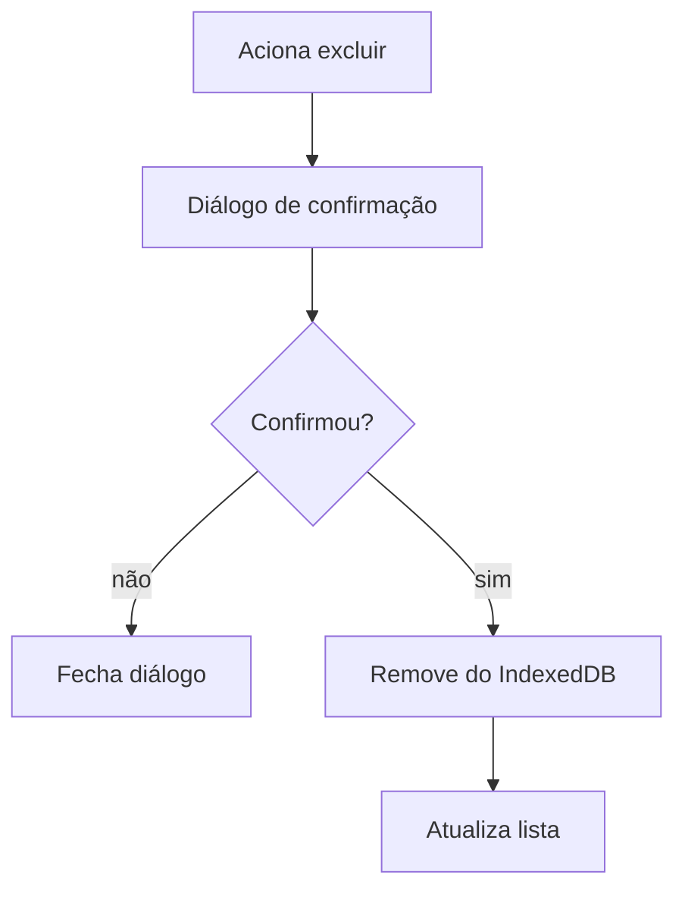

# CDU-06 — Excluir conteúdo

## Ator principal
Usuário

## Atores secundários
IndexedDB (browser)

## Pré-condições
- Existe ao menos um cartão na lista (`CDU-02`).

## Pós-condições
- Cartão removido do IndexedDB & da lista.
- Se era a última ocorrência de uma categoria, ela some do filtro (`CDU-08`).

## Fluxo principal
1. Usuário aciona o **icon button "excluir"** do cartão.
2. Sistema exibe diálogo de **confirmação** (`RB-04`).
3. Usuário confirma a exclusão.
4. Sistema remove o cartão do IndexedDB (`RNF-01`).
5. Sistema atualiza a lista (`CDU-02`).

## Fluxos alternativos / exceções
- **3a. Usuário cancela**: nenhum cartão é removido; diálogo é fechado.
- **4a. Falha ao remover**: sistema exibe erro & mantém o cartão; usuário pode tentar novamente.

## Regras de negócio
- `RB-04` (confirmação obrigatória).

## Requisitos não funcionais
- `RNF-01`, `RNF-06`, `RNF-08`, `RNF-13`.

## Diagrama

## Rastreabilidade
- Regras: `RB-04`.
- Relacionado: `CDU-02`, `CDU-08`.
