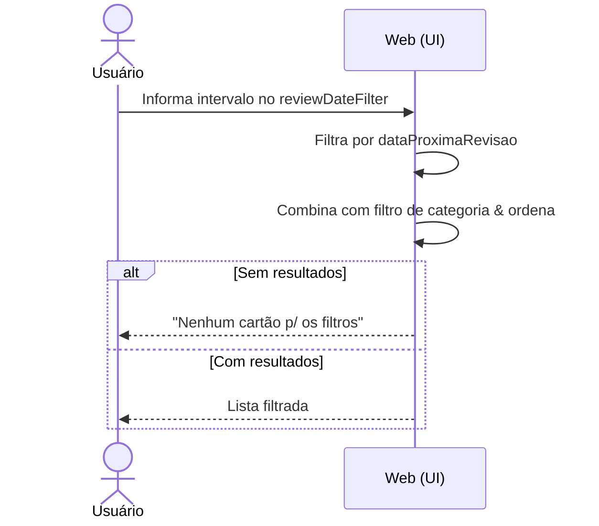
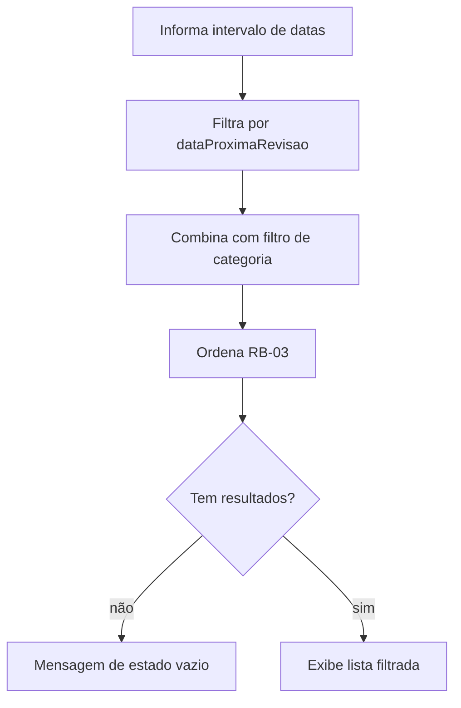

# CDU-07 — Filtrar por data de revisão

## Ator principal
Usuário

## Atores secundários
—

## Pré-condições
- Lista exibida (`CDU-02`).

## Pós-condições
- Lista exibida apenas com os cartões cuja `dataProximaRevisao` está dentro do intervalo informado.

## Fluxo principal
1. Usuário interage com o campo **`reviewDateFilter`** (filtro de data de revisão), informando um intervalo de datas.
2. Sistema filtra os cartões por `dataProximaRevisao` dentro do intervalo.
3. Sistema combina o resultado com os demais filtros ativos (`CDU-08`) & reaplica a ordenação (`RB-03`).
4. Sistema exibe a lista filtrada.
5. Usuário limpa o filtro → lista volta a exibir todos os cartões.

## Fluxos alternativos / exceções
- **4a. Nenhum resultado**: sistema exibe mensagem informando que não há cartões p/ aqueles filtros (`RB-05`).
- **1a. Intervalo inválido** (início > fim): sistema ignora || sinaliza o intervalo inválido.

## Regras de negócio
- `RB-03` (ordenação), `RB-05` (estado vazio).

## Requisitos não funcionais
- `RNF-04`, `RNF-05`, `RNF-07`.

## Diagrama

## Rastreabilidade
- Regras: `RB-03`, `RB-05`.
- Relacionado: `CDU-02`, `CDU-08`.
