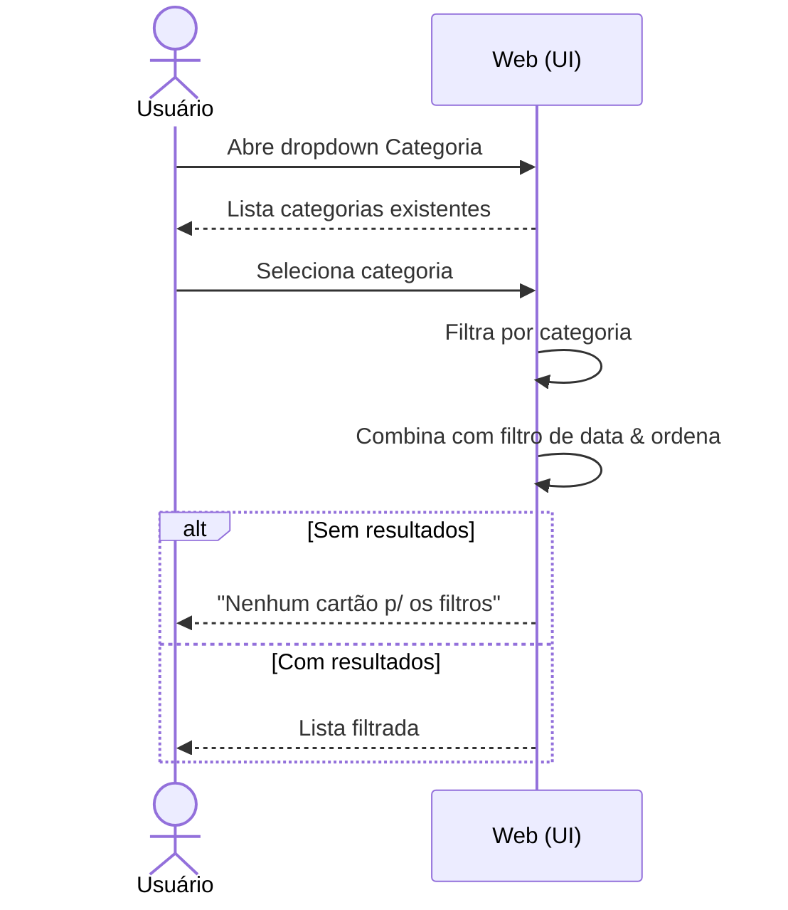
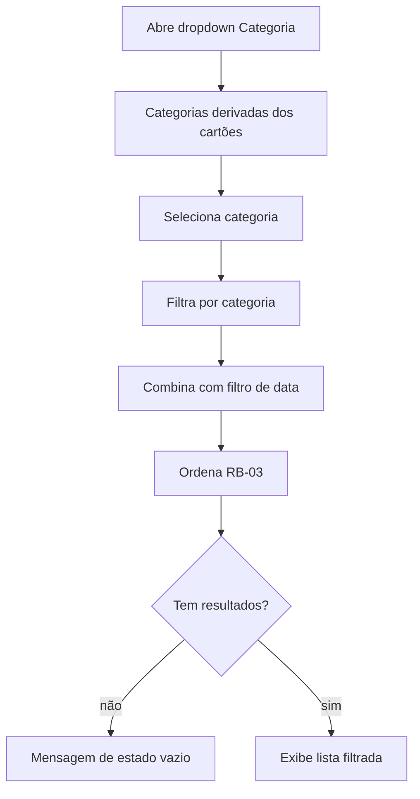

# CDU-08 — Filtrar por categoria

## Ator principal
Usuário

## Atores secundários
—

## Pré-condições
- Lista exibida (`CDU-02`).

## Pós-condições
- Lista exibida apenas com os cartões da categoria selecionada.

## Fluxo principal
1. Usuário abre o dropdown **Categoria**.
2. Sistema lista as categorias existentes, derivadas dos cartões (`RB-02`).
3. Usuário seleciona uma categoria.
4. Sistema filtra os cartões por `categoria`.
5. Sistema combina o resultado com os demais filtros ativos (`CDU-07`) & reaplica a ordenação (`RB-03`).
6. Sistema exibe a lista filtrada.
7. Usuário limpa o filtro → lista volta a exibir todos os cartões.

## Fluxos alternativos / exceções
- **2a. Nenhuma categoria disponível**: dropdown exibe estado vazio || fica desabilitado.
- **6a. Nenhum resultado**: sistema exibe mensagem informando que não há cartões p/ aqueles filtros (`RB-05`).

## Regras de negócio
- `RB-02` (categorias), `RB-03` (ordenação), `RB-05` (estado vazio).

## Requisitos não funcionais
- `RNF-04`, `RNF-05`, `RNF-06`, `RNF-08`, `RNF-10`.

## Diagrama

## Rastreabilidade
- Regras: `RB-02`, `RB-03`, `RB-05`.
- Relacionado: `CDU-02`, `CDU-05`, `CDU-06`, `CDU-07`.
