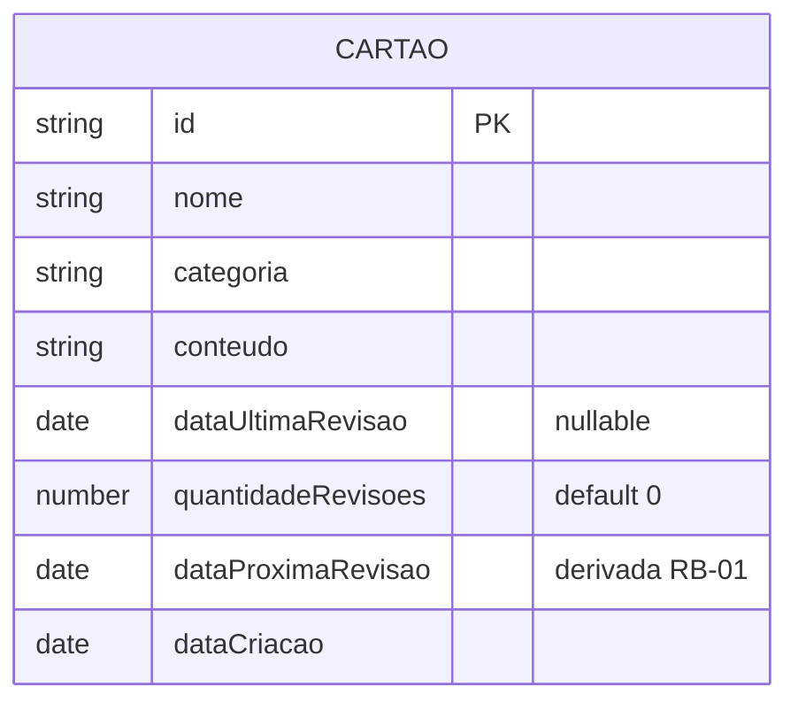
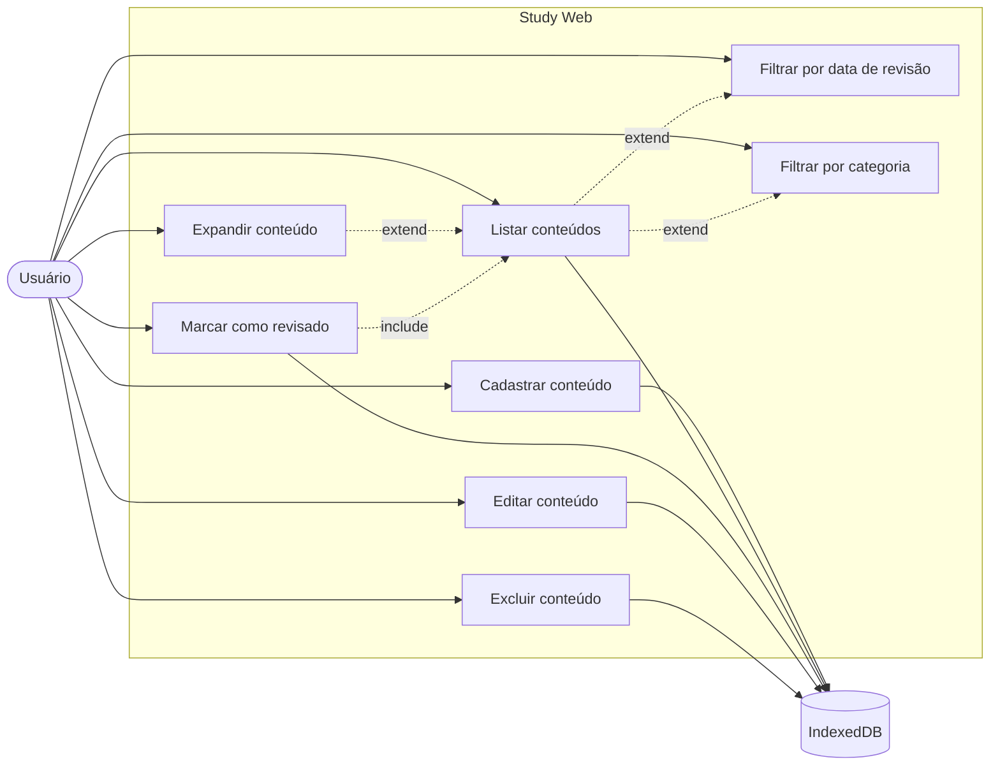

# Study Web — Visão geral

Aplicação web que ajuda o usuário a decidir a melhor data p/ revisar cada conteúdo, aplicando repetição espaçada. Na v1 os dados ficam **somente no browser do usuário** (IndexedDB), sem backend.

## Objetivo

- Calcular a próxima data de revisão de cada conteúdo a partir da data da última revisão & da quantidade de revisões anteriores.
- Mostrar os conteúdos ordenados pela próxima data de revisão.
- Permitir filtrar, expandir, editar, excluir & marcar como revisado.

## Atores

| Ator | Descrição |
| --- | --- |
| Usuário | Pessoa que cadastra & revisa conteúdos no browser. |
| IndexedDB (browser) | Armazenamento local persistente. Ator secundário do sistema. |

## Escopo (v1)

- CRUD de conteúdos (cartões) com nome, categoria, conteúdo, última revisão & contador de revisões.
- Cálculo automático da próxima data de revisão.
- Marcar conteúdo como revisado.
- Expansão inline do cartão p/ ver o conteúdo.
- Filtro por data de revisão & por categoria.
- Persistência local via IndexedDB.

## Fora de escopo (v1)

- Backend, sincronização entre dispositivos, contas de usuário.
- Notificações/e-mail de lembrete.
- Histórico detalhado de revisões (só guardamos a última data & o contador).
- Edição da fórmula de agendamento pelo usuário.
- Gestão de categorias como entidade separada (são texto livre derivado dos cartões).

## Glossário

| Termo | Definição |
| --- | --- |
| Cartão | Um conteúdo a revisar. Unidade de dados do app. |
| Categoria | Rótulo de texto livre associado a um cartão (ex.: "Inglês"). |
| Conteúdo | Texto do que deve ser revisado. Visível só com o cartão expandido. |
| Última revisão | Data em que o cartão foi revisado pela última vez (`null` se nunca). |
| Contador de revisões | Quantidade de revisões já realizadas. |
| Próxima data de revisão | Data calculada pela regra `RB-01`. |

## Requisitos não funcionais

| ID | Requisito |
| --- | --- |
| RNF-01 | Persistência 100% local no browser via IndexedDB; nenhum dado sai do dispositivo. |
| RNF-02 | Funciona offline após o primeiro carregamento. |
| RNF-03 | Interface em pt-BR. |
| RNF-04 | Layout responsivo, largura máxima de conteúdo **1024px**, com **40px** de padding lateral. |
| RNF-05 | Espaçamentos verticais conforme sketch: **40px** entre seções, **8px** entre cartões da lista, **20px** ao final da lista. |
| RNF-06 | Cada cartão colapsado mostra próxima data, nome & categoria; ações como icon buttons (marcar revisado, editar, excluir, expandir). |
| RNF-07 | Acessibilidade: elementos interativos com `aria-label` & navegação por teclado. |
| RNF-08 | Stack: TypeScript + React 19 (ver `apps/web`). |

## Regras de negócio

### RB-01 — Cálculo da próxima data de revisão

- `intervalo` (dias) = `7 × 2^(quantidadeRevisoes)`, limitado ao teto de **365 dias**.
  - 0 revisões → 7 · 1 → 14 · 2 → 28 · 3 → 56 · 4 → 112 · 5 → 224 · 6 → 365 · 7+ → 365.
- `dataProximaRevisao = base + intervaloEmDias`, com:
  - `base = dataCriacao` quando `quantidadeRevisoes = 0` (cartão nunca revisado);
  - `base = dataUltimaRevisao` caso contrário.
- Cartão novo nasce com `quantidadeRevisoes = 0` & `dataProximaRevisao = dataCriacao + 7 dias`.
- Ao marcar como revisado (`CDU-03`): `dataUltimaRevisao = hoje`, `quantidadeRevisoes += 1`, recalcular `dataProximaRevisao = hoje + min(7 × 2^quantidadeRevisoes, 365)`.
- Datas são dias de calendário (sem hora), comparadas no fuso local do usuário.

### RB-02 — Categorias

- Categorias são texto livre, **criadas pelo usuário** ao criar || editar um cartão.
- Ao digitar, o sistema sugere categorias já existentes nos cartões.
- O filtro de categoria (`CDU-08`) lista apenas as categorias presentes em algum cartão.
- !existe entidade "categoria" separada; a lista é derivada dos cartões.

### RB-03 — Ordenação da lista

- Ordem padrão: `dataProximaRevisao` ascendente.
- Empate: `nome` ascendente (ordem alfabética, pt-BR).

### RB-04 — Exclusão

- Excluir um cartão exige **confirmação** antes de remover.

### RB-05 — Estados vazios

- Sem cartões cadastrados: mensagem informando que não há cartões.
- Sem resultados após aplicar filtros: mensagem informando que não há cartões p/ aqueles filtros.

## Modelo de dados

Persistência: objeto único no IndexedDB (store `cartoes`, chave `id`). Detalhes de persistência são referenciados por todos os CDUs.

## Diagrama geral de casos de uso

Aproximação em mermaid (mermaid não possui diagrama UML de casos de uso). A versão UML formal está em [`cdu-geral.puml`](./cdu-geral.puml).

## Casos de uso

| ID | Nome | Ator principal |
| --- | --- | --- |
| [CDU-01](./Casos%20de%20uso/CDU-01%20-%20Cadastrar%20conteúdo.md) | Cadastrar conteúdo | Usuário |
| [CDU-02](./Casos%20de%20uso/CDU-02%20-%20Listar%20conteúdos.md) | Listar conteúdos | Usuário |
| [CDU-03](./Casos%20de%20uso/CDU-03%20-%20Marcar%20conteúdo%20como%20revisado.md) | Marcar conteúdo como revisado | Usuário |
| [CDU-04](./Casos%20de%20uso/CDU-04%20-%20Expandir%20conteúdo.md) | Expandir conteúdo | Usuário |
| [CDU-05](./Casos%20de%20uso/CDU-05%20-%20Editar%20conteúdo.md) | Editar conteúdo | Usuário |
| [CDU-06](./Casos%20de%20uso/CDU-06%20-%20Excluir%20conteúdo.md) | Excluir conteúdo | Usuário |
| [CDU-07](./Casos%20de%20uso/CDU-07%20-%20Filtrar%20por%20data%20de%20revisão.md) | Filtrar por data de revisão | Usuário |
| [CDU-08](./Casos%20de%20uso/CDU-08%20-%20Filtrar%20por%20categoria.md) | Filtrar por categoria | Usuário |

## Histórias de usuários

Ver [Histórias de usuários](./Histórias%20de%20usuários/index.md) — 10 HUs com critérios de aceite em Gherkin, prioridade (MoSCoW) & estimativa (SP), mapeadas aos CDUs & regras.
